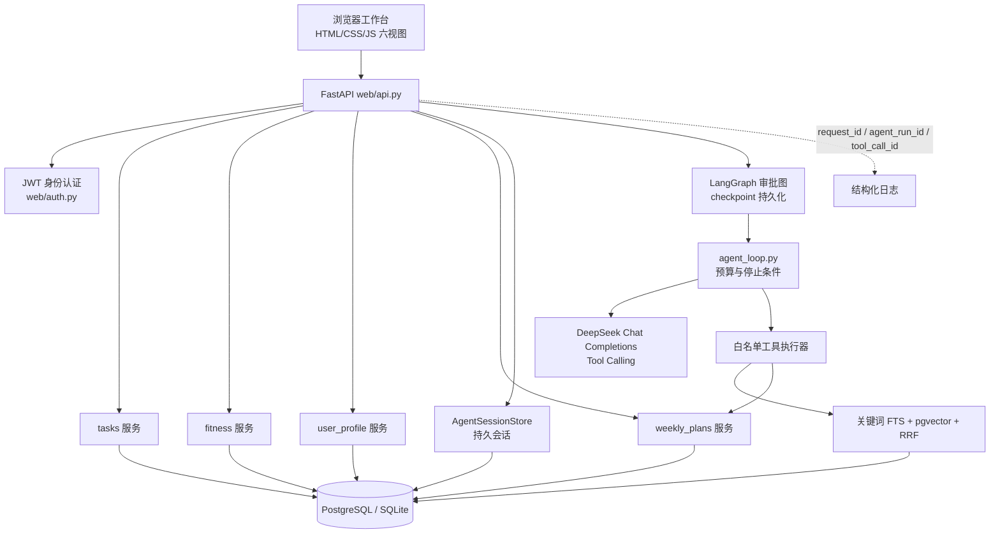

# 知行 · KnowDo

**知是资料与检索，行是任务、计划与训练，确认是二者之间的闸门——面向个人学习与训练的知识库 Agent 工作台。**

上传资料、问它问题；安排任务、记录用时；练完力量、记录重量；每个周一，让它基于你的档案和上一周的真实进展生成周计划——但计划只是提案，**必须由你确认才会变成任务**。

[](https://github.com/4yeo-1114/Know-Do/actions/workflows/study-task-assistant.yml)
[](https://www.python.org/)
[](https://fastapi.tiangolo.com/)
[](https://www.postgresql.org/)
[](https://api-docs.deepseek.com/)
[](https://langchain-ai.github.io/langgraph/)
[](KnowDo/docs/images/desktop-1440x900-overview.png)

<p align="center">
  
  <br><sub>桌面端 · 总览（真实 Edge 浏览器端到端验收截图）</sub>
</p>

<p align="center">
  
  <br><sub>周计划视图：模型生成 pending 提案，确认后才落库为正式任务</sub>
</p>

<p align="center">
  
  <br><sub>移动端 390×844 · 任务视图（全部 10 张截图见 <a href="KnowDo/docs/images/">docs/images/</a>）</sub>
</p>

---

## 克隆与快速开始

### 0. 克隆到本地

```bash
git clone https://github.com/4yeo-1114/Know-Do.git
cd Know-Do
```

### 方式一：Docker Compose（推荐，PostgreSQL + pgvector + RAG 全功能）

```bash
cd KnowDo
cp .env.compose.example .env   # 填入 STUDY_POSTGRES_PASSWORD、STUDY_TASK_SECRET_KEY（随机字符串）
docker compose up --build      # api 容器启动时自动执行 alembic upgrade head
```

启动后：

- 工作台：<http://127.0.0.1:8001/app/>
- Swagger API 文档：<http://127.0.0.1:8001/docs>

DeepSeek 问答需要真实 API Key：在 `.env` 中补 `DEEPSEEK_API_KEY`。首次启动会下载 embedding 模型（`BAAI/bge-small-zh-v1.5`）到 `fastembed_cache` 卷，稍等片刻。

### 方式二：本地 venv（SQLite，无 RAG 的轻量体验）

```powershell
cd KnowDo
python -m venv .venv
.\.venv\Scripts\pip install -r requirements.txt

# .env 中至少配置：
#   DATABASE_URL=sqlite:///./study_tasks.db
#   STUDY_TASK_SECRET_KEY=<至少 32 字节的随机串>

.\.venv\Scripts\python.exe -m alembic -c alembic.ini upgrade head
.\.venv\Scripts\python.exe -m uvicorn api:app --reload
```

工作台在 <http://127.0.0.1:8000/app/>。注意：向量检索依赖 pgvector，SQLite 模式下 RAG 不可用，任务、计划、档案与训练功能不受影响。

### 跑测试

```powershell
cd KnowDo     # 测试位于仓库根的 tests/
.\.venv\Scripts\python.exe -m pytest -q
```

## 使用流程

第一次上手，按这个顺序走一遍：

1. **注册并登录**：打开工作台 <http://127.0.0.1:8001/app/> 注册账号（用户名 ≥3 字符、密码 ≥8 字符）。命令行等价操作：

   ```bash
   curl -X POST http://127.0.0.1:8001/auth/register \
     -H "Content-Type: application/json" \
     -d '{"username":"alice","password":"12345678"}'
   curl -X POST http://127.0.0.1:8001/auth/login \
     -d "username=alice&password=12345678"    # 返回 Bearer 令牌
   ```

2. **任务视图**：新建学习/健身任务，完成时填写实际用时——总览会统计完成进度与用时。
3. **训练视图**：手动记录训练场次与动作组，或把 CSV 粘贴导入（先预览校验、再提交；相同内容重复导入不会产生重复数据）。
4. **资料库视图**：上传 Markdown / TXT / 文本型 PDF，等它变 `ready`。
5. **Agent 视图**：直接提问。有资料证据时回答附来源引用；没有证据时明确拒答。也可以让它"帮我创建任务"——它只会生成提案，你点确认后才真正写入。
6. **档案与计划视图**：填写学习档案（目标、每日分钟、训练频次），生成周计划；确认后计划里的任务才会落库。下周生成调整提案，同样需要你确认。
7. **API 调试**：Swagger 文档 <http://127.0.0.1:8001/docs> 覆盖全部端点。

## 项目缘起

这是一个从零写起的后端学习项目：一开始只是 CLI 里的任务 CRUD，然后一步一步长成今天的样子——JSON 存储、SQLite、FastAPI、认证与用户隔离、PostgreSQL、RAG 检索、工具调用 Agent、写入确认、持久会话、浏览器工作台。每个阶段都先解决一个真实问题，再进入下一阶段。

做这个项目时反复撞上三个问题，它们决定了现在的架构：

1. **模型不可信**：大模型会编造事实、写坏数据。所以它只能"建议"，写库必须经过用户确认。
2. **检索不能脱离资料**：RAG 的上下文必须来自你上传的资料，没有证据时要明确拒答。
3. **数据不能越界**：多用户下，隔离必须发生在资料进入应用和模型**之前**，而不是"查出来再过滤"。

## 核心特性

### 🧭 六视图浏览器工作台

原生 HTML/CSS/JS 实现，无框架依赖：**总览、任务、训练、资料库、Agent、档案与计划**。支持任务实际用时记录、训练量/个人纪录/周均体重统计、CSV 预览→提交两阶段导入、资料生命周期、跨刷新恢复的 Agent 会话。前端零信任：不接收也不保存 `owner_id`。

### 📚 带来源引用的 RAG 问答

上传 Markdown、TXT 或文本型 PDF，系统切块并生成向量；提问时关键词全文检索（PostgreSQL `tsvector` + GIN）与 pgvector 向量检索双路召回，RRF 融合排序，回答附来源引用。**检索不到证据时明确拒答**，而不是让模型自由发挥。

### 🤖 提案-确认式 Agent 写入

模型只能产出工具调用提案：服务端执行工具白名单、Pydantic 参数校验与步数/Token/工具调用预算预检。创建任务、周计划都是 **pending 提案**，你确认后服务端才在同一事务内**重新校验** owner、版本与幂等键，然后写入。条件更新与唯一约束防止重复创建，失败整批回滚。

### 📅 周计划闭环：从档案到任务

计划工具必须先从 `get_planning_context` 读取你的显式档案（学习目标、每日分钟、训练频次）和上周真实进展，才能生成提案。确认时校验 `revision` 与 `plan_version`——你改过档案或已有新计划，旧提案会返回 409。下一周的计划调整提案，同样需要你确认。

### 🔐 用户级数据隔离

身份只来自 JWT：`Authorization` 头 → 验签 → `sub` 作为可信 `user_id`，之后所有 SQL 都在 `WHERE owner_id = :owner_id` 与文档 `ready + active_version` 条件下执行。浏览器端用第二账号实测：跨用户访问任务、会话、计划一律 404。

### 🧪 真实浏览器端到端验收

Playwright 驱动真实 Edge，8 场景 76 项检查：登录、任务完成落库、计划确认、会话恢复、网络故障三组恢复、跨账号隔离、重复提交防护、桌面/移动布局与 Canvas 渲染。这套验收曾抓出两个真实缺陷（实际分钟丢失、聊天重复提交双写），修复后 76/76 全绿，缺陷与修复均有数据库实证。

## 系统架构



运行时有三类存储，各司其职：

| 存储 | 内容 | 为什么存在 |
|---|---|---|
| 业务 SQL 表 | 用户、任务、计划、训练、资料、会话消息 | 业务事实与事务权威 |
| pgvector `document_chunks` | 文本 chunk、512 维 embedding、版本/页码元数据 | 向量检索与混合召回 |
| LangGraph checkpoint | 审批图的暂停/恢复状态 | 恢复控制流，不替代业务事务 |

## API 一览

| 分组 | 端点 | 说明 |
|---|---|---|
| 认证 | `POST /auth/register` `POST /auth/login` | 注册；登录返回 Bearer 令牌（Argon2 密码哈希 + JWT） |
| 任务 | `GET/POST /tasks` `GET/PATCH/DELETE /tasks/{id}` `GET /tasks/progress` | 任务 CRUD 与完成进度统计 |
| 档案 | `GET/PUT/DELETE /profile` | 显式档案（学习目标、每日分钟、训练频次），带 revision 乐观并发 |
| 周计划 | `POST /plans/weekly` `GET /plans/current` `GET /plans` `GET /plans/{id}` `POST /plans/{id}/confirm` `POST /plans/{id}/reject` `POST /plans/{id}/adjust` `GET /plans/{id}/workflow` | 提案生成、确认/拒绝、调整与审批状态查询 |
| 训练 | `POST /fitness/workouts` `POST /fitness/weight` `GET /fitness/progress` `POST /fitness/import/preview` `POST /fitness/import/commit` | 训练/体重记录、聚合统计、CSV 两阶段导入（幂等） |
| 资料 | `POST /documents` `POST /documents/file` `GET /documents` `GET/DELETE /documents/{id}` | 文本/PDF 上传、生命周期状态与删除 |
| Agent | `POST /agent/chat` `GET /agent/sessions/{id}` `POST /agent/task-proposals` `GET /agent/task-proposals/{id}` `POST /agent/task-proposals/{id}/confirm` | 多轮会话、持久会话读取、任务提案与确认 |
| 静态 | `GET /app/` | 六视图工作台 |

错误码有固定语义：JWT 无效/过期 `401`；工具名或参数不合法 `422`；提案幂等冲突 `409`；Agent 预算或步数耗尽 `429`；DeepSeek 上游失败 `502`；本地模型/RAG 运行时不可用 `503`。

## 关键设计

这一节回答七个"为什么"，是理解整个项目的最佳路径。

### 1. 为什么模型不能直接把建议写进数据库？

因为模型输出是不可信的。写路径是**提案 → 确认**：

```text
DeepSeek 返回 create_task / 计划工具 tool_call
  → 服务端校验工具名、参数、预算（白名单内才执行）
  → 只写入 pending 提案（15 分钟有效期），业务表不变
  → 用户调用 confirm 接口
  → 服务端在同一事务内重新校验 owner、档案/计划版本、幂等键
  → 条件更新 + 唯一约束防重复，确认并写入正式记录
```

`tool_call_id` 只标识模型的一次调用；`proposal_id` 是数据库里的业务提案，两者不能混用。这套路径用 **79 项确定性行为场景**验证（身份隔离、多轮会话、审批恢复、停止边界），并专项覆盖同计划并发确认、失败整批回滚与同键幂等恢复。

### 2. 为什么隔离必须发生在 SQL 层？

如果"先查出结果再按用户过滤"，数据就已经进入了应用和模型上下文——这是泄露窗口。本项目把隔离推到最前：

```text
Authorization header → JWT 验签 → sub = 可信 user_id
  → 所有查询携带 WHERE owner_id = :owner_id
  → RAG 额外要求 state='ready' AND document_version = active_version
```

`owner_id` 不从请求 body、工具参数或模型输出中读取。浏览器端用第二账号实测跨用户访问任务、会话、计划均返回 404。

### 3. 一次周计划确认，什么时候会返回 409？

三种情况：你确认前**改过档案**（revision 不匹配）；已有**更新的计划**（plan_version 落后）；**同键并发确认**（幂等键/唯一约束冲突）。409 是设计出来的结果，不是故障——它保证旧提案永远不能覆盖新事实。并发确认由行锁 + 单事务保证，实测通过。

### 4. 资料上传失败后，旧资料还能用吗？

能。文档有显式生命周期：

```text
pending → processing → 切块 + embedding + 写入新版本 → ready（切换 active_version）
                                    ↘ 失败 → failed（旧 ready/active 版本保留）
```

检索 SQL 同时过滤 `state='ready'` 与 `active_version`，半成品、失败版本和旧版本永远不会进入 RAG 上下文。删除与激活在同一事务内完成，行锁保护并发激活。

### 5. 刷新页面后，Agent 还认得我吗？

认得。会话 ID 是服务端校验过的 UUID，浏览器把它存在 localStorage；消息、运行记录与 LangGraph checkpoint 持久化。审批流程使用 LangGraph 的 `interrupt/resume`：确认中途关掉页面，下次打开可以继续。`(session_id, sequence)` 唯一约束与原子序号分配保证消息不会乱序或重复。

### 6. 关键词检索凭什么做到 P50 3.41ms？

PostgreSQL 全文检索的三个决定：受限 token 白名单（只放行安全的关键词 token）、OR `to_tsquery`（不要求全部词命中）、GIN 索引。它与 pgvector 双路召回、RRF 融合排序。实测数据见下表——同时如实保留"无答案正确率 0.900→0.800"的取舍：宁可不答，也不答错。

### 7. 什么可以重试，什么不可以？

- **可以**：模型的 HTTP 请求（网络抖动、上游 5xx）按策略有限重试；
- **不可以**：本地工具执行——它可能有副作用（写库、删数据），放进重试器会造成重复执行；
- 因此重试边界画在"纯网络调用"上，副作用操作靠事务、幂等键和唯一约束兜底。

## 实测数据

> 全部数字来自真实运行报告（本仓库 `benchmarks/` 下保留原始证据），可对照 [KnowDo/PROJECT_PORTFOLIO.md](KnowDo/PROJECT_PORTFOLIO.md) 的指标来源清单逐条溯源；**不代表在线规模或生产并发容量**。

### RAG 检索（同一 120 条人工核验题集，每策略 5 轮共 600 次测量）

| 指标 | 改造前 | 改造后 |
|---|---:|---:|
| 关键词 Recall@5 | 0.675 | **0.925** |
| 关键词 MRR@5 | 0.650 | **0.879** |
| 关键词 P50 延迟 | — | **3.41ms**（同轮向量 11.39ms / 混合 15.12ms） |
| 无答案正确率 | 0.900 | 0.800（如实保留的取舍） |

范围：10 条合成语料与独立实验库。

### 测试规模（2026-10-23 仓库 head 本地实测）

| 套件 | 结果 | 环境 |
|---|---|---|
| 全量回归（SQLite） | 357 项收集，0 失败（10 跳过） | 本地 venv |
| PostgreSQL 专项 | **356 passed / 1 skipped** | 真实 PostgreSQL + pgvector |
| 浏览器端到端 | **8 场景 76/76**，page_errors=0 | Playwright + 真实 Edge |
| 确定性行为场景 | 79 项全部通过 | 离线桩模型 |
| CSV 幂等探针 | 10/10 轮，业务数据恰好一份 | 双线程 + 真实 PostgreSQL |

浏览器 E2E 使用离线桩模型，验证的是**浏览器控制流、故障恢复与写入行为**，不代表 DeepSeek 在线回答质量。E2E 还曾抓出两个真实缺陷并完成修复验证：任务完成时实际分钟丢失、聊天重复提交双写——均以数据库落库结果为证。

## 目录结构

```text
.
├── README.md                    # 本文件
├── KnowDo/        # 应用源码（FastAPI + Agent + 前端工作台）
│   ├── api.py                   # Uvicorn 入口（只导出应用工厂）
│   ├── web/                     # HTTP 路由、JWT 认证、请求/响应模型
│   ├── agent/                   # Agent 循环、工具执行、持久会话、审批图
│   ├── llm/                     # DeepSeek 客户端、工具 schema、SSE 解析
│   ├── tasks/                   # 任务业务、写入提案与确认事务
│   ├── fitness/                 # 训练/体重、CSV 校验与幂等导入
│   ├── user_profile/            # 显式档案与 revision
│   ├── weekly_plans/            # 周计划校验、版本、确认与调整
│   ├── knowledge/               # 文档生命周期、关键词/向量/混合检索、RAG 评测
│   ├── storage/                 # ORM 模型、Session、pgvector SQL
│   ├── core/                    # 结构化日志（request_id）与重试策略
│   ├── frontend/                # 六视图工作台（index.html / app.css / app.js）
│   ├── migrations/              # Alembic 迁移
│   ├── legacy/                  # 早期 CLI 与 SQLite 学习实现
│   ├── examples/                # 单模块演示
│   └── docs/images/             # 浏览器验收截图
├── tests/                       # 全量 pytest（含 PostgreSQL 专项）
├── benchmarks/                  # 原始实验与验收证据（报告、截图、DB 实证）
├── docs/                        # 证据账本、演示脚本、源码讲解
└── .github/workflows/           # CI：push / PR 触发全量测试
```

## 文档索引

| 文档 | 内容 |
|---|---|
| [KnowDo/ARCHITECTURE.md](KnowDo/ARCHITECTURE.md) | 架构、Agent 数据流、权限边界、错误映射（部分章节为早期版本，以代码为准） |
| [KnowDo/MODULE_LAYOUT.md](KnowDo/MODULE_LAYOUT.md) | 目录职责与请求链路 |
| [KnowDo/AUTH.md](KnowDo/AUTH.md) | 注册/登录与任务隔离 |
| [KnowDo/WRITE_CONFIRMATION.md](KnowDo/WRITE_CONFIRMATION.md) | 任务提案与确认机制 |
| [KnowDo/RAG.md](KnowDo/RAG.md) | RAG 与关键词检索基线 |
| [KnowDo/DOCKER.md](KnowDo/DOCKER.md) | Compose 环境、端口与网络 |
| [KnowDo/QUALITY_REPORT.md](KnowDo/QUALITY_REPORT.md) | 项目质量与失败复盘 |
| [KnowDo/FINAL_ACCEPTANCE.md](KnowDo/FINAL_ACCEPTANCE.md) | 最终验收场景（演示与面试复盘） |
| [KnowDo/PROJECT_PORTFOLIO.md](KnowDo/PROJECT_PORTFOLIO.md) | 简历亮点与指标来源清单 |
| docs/UASB源码架构与进度讲解.md | 当前源码逐模块拆解（面试讲解用） |
| docs/UPG06证据账本.md | 全部可引用证据、运行范围与禁用说法 |
| docs/UPG06演示与面试脚本.md | 演示流程与面试追问 |

> `docs/` 下的三份文档是本地求职材料，不随仓库发布（见仓库根 `.gitignore`），仅在本地阅读。

## 演进路线

```text
CLI 任务 CRUD → JSON → SQLite → FastAPI → 认证与用户隔离
  → PostgreSQL / Docker → DeepSeek 真实 API → 工具调用 Agent
  → 提案确认写入 → RAG（关键词 → FTS + 向量 + RRF）
  → 文档生命周期与 PDF → 持久会话与审批图（LangGraph）
  → 六视图浏览器工作台 → 浏览器端到端验收与证据整理
```

## 当前限制

- 资料解析支持纯文本与**文本型 PDF**；扫描件/加密 PDF 返回 415，暂不做 OCR，无 Word 解析。
- 检索评测基于合成语料与独立实验库，未做大规模容量压测。
- 浏览器 E2E 使用离线桩模型，在线回答质量、费用与 Compose 全链路未在验收范围。
- 架构保持单体、单用户主场景，不引入微服务或复杂多 Agent。

---

**一句话总结：这是一个"模型只能建议、用户负责确认、事实以数据库为准"的学习与训练 Agent 工作台。**
